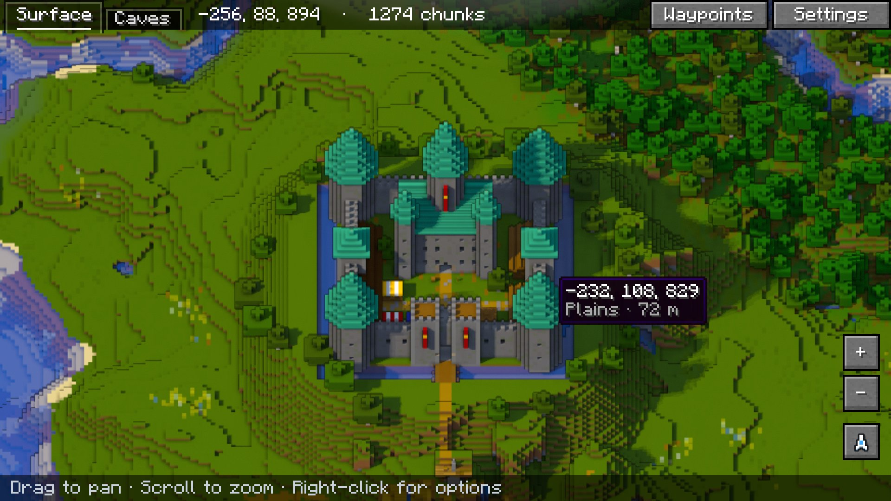
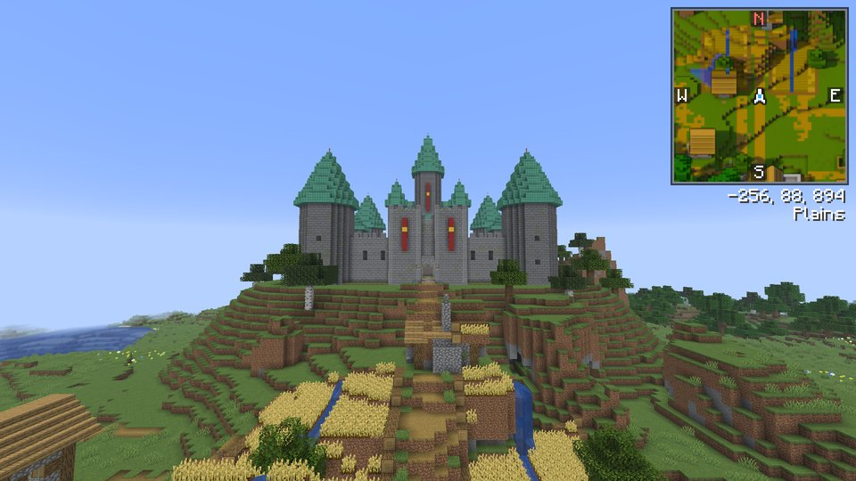
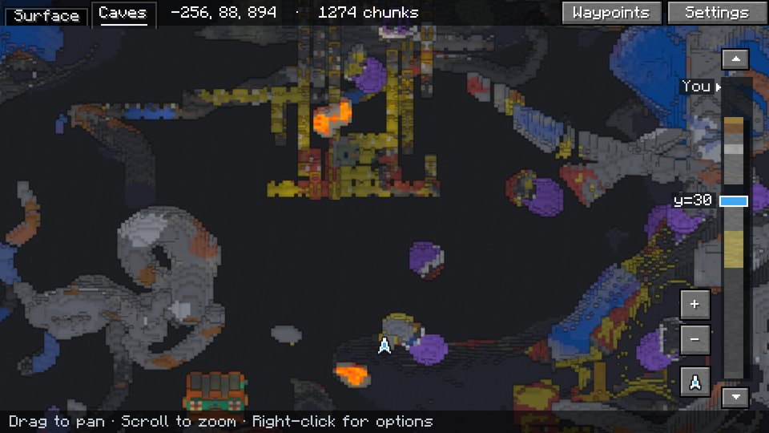
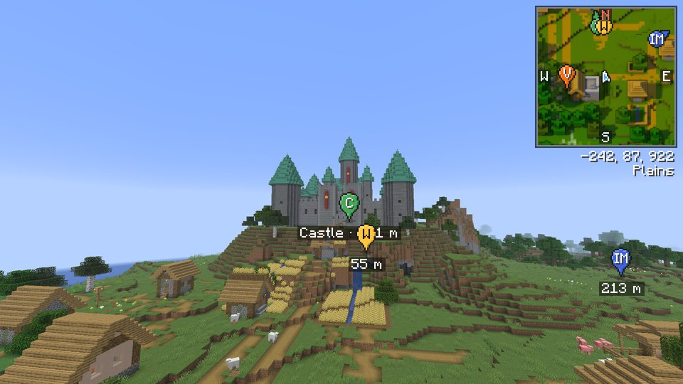
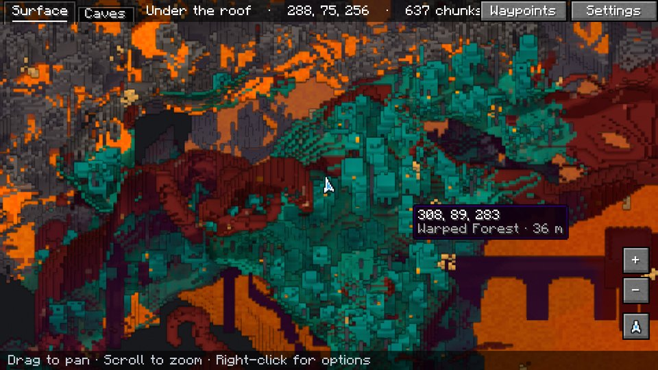

# Diorama

A minimap and world map for Minecraft that draws your world at an angle, like a little model of it on a table. Towers stand up, cliffs have faces and trees cast shadows.

**Download:** [Modrinth](https://modrinth.com/mod/diorama-map) · [CurseForge](https://www.curseforge.com/minecraft/mc-mods/diorama) · [GitHub releases](https://github.com/SunkenInTime/diorama/releases)

## What you get

- **A minimap** in the corner of your choice, square or round, with a compass, your coordinates and the biome.
- **A fullscreen map** you can drag and zoom, from single blocks out to about 10,000 blocks across.
- **Dimension browsing.** Overworld, Nether and End buttons on the fullscreen map open each dimension's saved terrain without travelling there. Each remembers its camera; waypoints, drawings and exports use the selected dimension. Unvisited areas stay under fog.
- **A map that remembers.** Everywhere you've been is saved, per world and dimension, so it's still there next time. Places you haven't seen yet sit under drifting fog.
- **Caves and the Nether.** Underground, the map shows the cave you're in. In the Nether it looks in under the bedrock roof.
- **A radar** that shows players and mobs as their own faces, outlined red, yellow or green for hostile, neutral or passive.
- **Waypoints** on the map and floating in the world, with an icon or up to four letters on each pin, a marker where you died, a pin on the bed you last slept in, folders to sort them, a distance limit for when there are too many, and an [Add] link when someone shares one in chat.
- **A right-click menu** on the map to add a waypoint, drop a temporary one, share the spot in chat, or teleport there if you're allowed to use `/tp`.
- **Drawing on the map.** The pencil beside the zoom buttons lets you draw freehand, click out lines, mark areas, leave notes and measure how far apart two places are, in the waypoint colours. Drawings stay put at every zoom and show on the minimap too.

| | |
| --- | --- |
|  |  |
|  |  |

## Install

1. Install [Fabric](https://fabricmc.net/use/) with [Fabric API](https://modrinth.com/mod/fabric-api), [NeoForge](https://neoforged.net/), or [Forge](https://files.minecraftforge.net/) for 1.20.1.
2. Download the Diorama file for your Minecraft version and loader, and put it in your `mods` folder.

Diorama runs on Fabric for Minecraft 1.20.1, 1.21 to 1.21.11 and 26.1 to 26.3, and on NeoForge for every version NeoForge has a stable release for: 1.21, 1.21.1, 1.21.3, 1.21.4, 1.21.5, 1.21.8, 1.21.10, 1.21.11, 26.1.2, 26.2 and 26.3. On Forge it runs on 1.20.1, with Forge 47.1 or later.

It only runs in your game. Servers don't need it.

## Keys

| Key | What it does |
| --- | --- |
| `M` | Open the fullscreen map |
| `B` | Add a waypoint where you're standing |
| `U` | List your waypoints |
| `=` / `-` | Zoom the minimap in and out |

You can change these in Minecraft's **Controls** screen, under Diorama. Map settings and hiding the minimap have keys too, unbound until you set one.

On the fullscreen map, drag to move around, scroll to zoom, click a waypoint to edit it and right-click anywhere else for the menu. `C` switches between the surface and the cave view, `PgUp` and `PgDn` move the cave view up and down, and `Space` brings the map back to you. While drawing, right-drag moves the map, `Ctrl+Z` undoes and `Esc` stops drawing.

The fullscreen map can also show the chunk grid, slime chunks (singleplayer only) and the spots where monsters can spawn. Turn them on in the settings.

## Settings

Open them with the **Settings** button on the fullscreen map, or from the mod list (Mod Menu on Fabric). They cover the minimap's size, opacity, shape, corner and frame, which mobs the radar shows and how, how waypoints look in the world, and more.

- **Slower computer?** Set **Quality** to Fast. The map fills in about four times sooner and the fog is cheaper to draw.
- **GPU baking** draws the map on your graphics card instead of the processor, so it fills in faster and the game uses less CPU. It's experimental and off until you turn it on. If your graphics card draws the map differently from the processor, Diorama turns it back off and tells you.
- **Sharing your settings.** They're saved in `.minecraft/diorama/config.json`. Copy that file into a friend's `.minecraft/diorama/` folder to give them the same setup.

Your maps and waypoints are saved next to it, in `.minecraft/diorama/`, one folder per world.

## On servers

Each world on a server gets its own map and waypoints. Diorama tells worlds behind one address apart by their seed, so a network's lobby and survival worlds, or a map reset, get separate maps. Worlds that share a seed share a map, unless the server sends a level ID for each world, as servers set up for Xaero's mods do. Realms get their own too.

Servers can limit Diorama with the same chat codes Xaero's Minimap uses. "Fair play" turns off the radar and only shows caves you've actually seen. "No minimap" turns the map off.

## Works with

- **Xaero's Minimap.** The waypoint list can import your Xaero waypoints, shared Xaero waypoints get an [Add] link, and on servers with Xaero's player tracking you can see far-away players on the map.
- **Radar icon packs** made for Xaero's Minimap work in Diorama too. You can also make your own: see [Custom radar icons](docs/radar-icons.md).
- **Resource packs** can redraw the waypoint icons or add new ones: an 11x11 picture in `assets/<namespace>/textures/waypoint_icons/`, with a dark outline, like the ones Diorama ships in `assets/diorama/textures/waypoint_icons/`.
- **Waystones.** Waystones you've found show on the map in a folder of their own.
- **FTB Chunks.** Claimed land shows on the map and minimap in its team's colour, with a stronger edge where the owner changes. Hover over it to see who owns it. Where the claims show is a setting under Overlays.
- **Create copycats** (and Copycats+) show on the map as the block they copy.

## Help and contributing

Found a bug or want something added? [Open an issue](https://github.com/SunkenInTime/diorama/issues).

Want to build Diorama yourself or help out? [Building and testing](docs/development.md) has the details.

Diorama is under the [MIT license](LICENSE).
